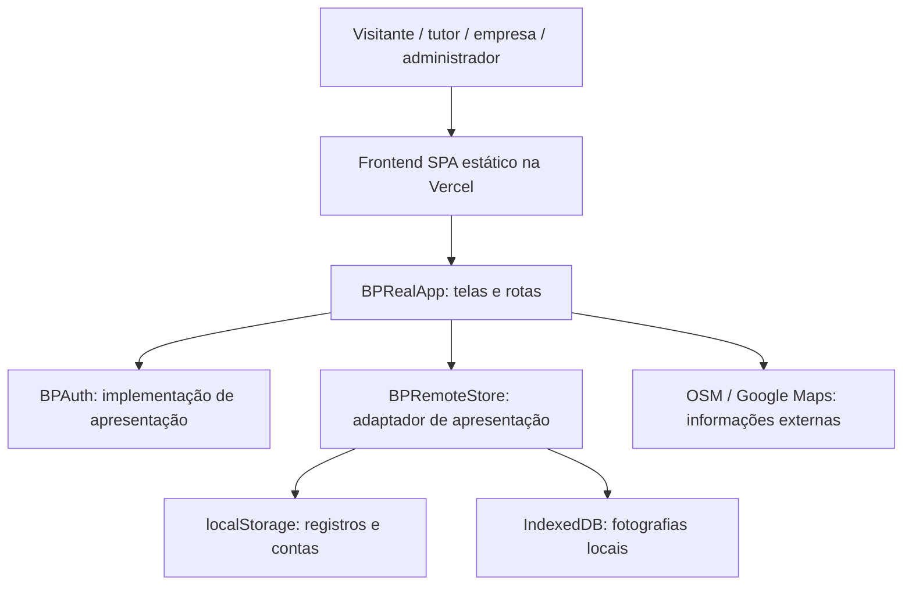

# Arquitetura do BuscaPet — estado publicado em 24/11/2026

Este é o estado da **versão acadêmica do Projeto Integrador II**, servida em `https://busca-pet-delta.vercel.app/`. A baseline funcional é `2507a68`. A descrição histórica da Sprint 2 permanece integralmente no anexo abaixo, mas não descreve a implantação usada na apresentação.

## Visão de implantação efetiva



O comando `npm run build:presentation` gera o frontend estático. `src/local-preview.js` disponibiliza implementações locais dos contratos `BPAuth` e `BPRemoteStore`, e `src/events.js` monta a `BPRealApp`. O frontend pode receber outra implementação desses contratos em uma etapa posterior; isso não significa que use banco remoto nesta entrega.

## Módulos e responsabilidades verificadas

| Arquivo | Responsabilidade da versão acadêmica |
|---|---|
| `src/main.js` | Importações e ordem de inicialização |
| `src/events.js` | Inicialização e listeners globais |
| `src/real-app.js` | Telas, navegação, formulários e composição da UI |
| `src/local-preview.js` | Persistência local, contas, perfis, validação e verificação de propriedade |
| `src/permissions.js` | Autorização por papel/ação no cliente |
| `src/pet-poster.js` | Construção do cartaz no Canvas |
| `src/pet-matching.js` | Comparação pontuada de alertas por características |
| `src/nearby-services.js` | Diretório público e consulta de serviços próximos |
| `src/search-map.js` | Exibição e interação de regiões aproximadas |
| `src/images.js`, `src/views.js` | Reuso de recursos de imagem e apresentação |

## Regras de domínio e limites arquiteturais

**Regra de propriedade:** tutor, administrador e empresa podem ter pets próprios; operações de escrita local verificam identidade e dono dos registros. **Empresas:** cadastro pendente → aprovação por admin → exibição na Rede de Apoio; editar informações após aprovação retorna à análise. **Cartaz:** dados públicos e WhatsApp somente com consentimento do titular. **Correspondências:** alertas públicos ativos de tipos opostos, com justificativas e ordenação; não identifica animais por reconhecimento visual.

`localStorage` não fornece transações ACID nem colaboração entre navegadores. As verificações de permissão no frontend ajudam a demonstrar regras de negócio, mas **não são uma barreira de segurança contra manipulação local**. Uma implantação pública exigiria Auth de servidor, banco compartilhado, controle RLS, tratamento de dados pessoais e testes com identidades reais distintas.

**Manutenibilidade:** arquivos especializados mostram coesão por responsabilidade, mas `real-app.js` continua extenso e existem interfaces via `window`. Trate isso como dívida técnica, não como demonstração de SOLID/MVC em sentido integral.

**Evidências:** [dossiê da entrega](ENTREGA_PROJETO_INTEGRADOR_II_2026-11-24.md) e [perguntas de defesa](PERGUNTAS_ENGENHARIA_PI2.md).

---

## Anexo histórico — transição para Sprint 2


## Visão geral

O BuscaPet preserva a SPA estática e passa a usar Vite para desenvolvimento e
build. `src/main.js` importa os módulos legados em ordem explícita; seus
contratos globais são temporários até a migração completa para ESM.

```text
constants → storage → validation → store → auth → permissions
          → router → legal → images → views → app → events
```

| Módulo | Responsabilidade |
|---|---|
| `constants` | vocabulário compartilhado, versões e chaves |
| `storage` | leitura/gravação defensiva, serialização e cópias |
| `validation` | identidade, entradas operacionais, estados e migração |
| `store` | transações e regras do domínio |
| `auth` | contas, identidade e sessão simuladas |
| `permissions` | autorização por ação, função ativa e relação com recurso |
| `router` | rotas, hash, guards e retorno após login |
| `images` | arquivo, limite, redimensionamento e cancelamento entre rotas |
| `views` | escape, ícones e componentes repetidos |
| `app` | composição das telas e controladores de formulário/ação |
| `events` | listeners globais registrados uma única vez |

## Identidade, função e permissão

Os conceitos são separados:

```text
autenticação       → quem é a pessoa
funções concedidas → o que a conta pode exercer
função ativa       → qual área a interface apresenta
permissão          → se a ação é válida para este recurso
```

`BPAuth` expõe `getSession`, `getCurrentUser` (com `getUser` mantido por compatibilidade), `getRoles`, `getActiveRole`, `hasRole`, `hasAnyRole`, `requireSession` e `requireRole`. `BPPermissions.can(action, resource)` e `require` centralizam a função necessária; `BPStore` continua verificando propriedade, participação, atribuição, estado da conta e estado do recurso dentro da transação.

Uma conta Tutor + Colaborador conserva uma identidade e sessão. Apenas a função ativa muda. Moderador vem do seed, e Administrador não possui concessão pública.

## Fluxo de uma mutação

As operações do `BPStore` seguem o mesmo limite transacional:

1. normalizam e validam a entrada recebida;
2. verificam se outra aba mudou a base desde a leitura;
3. clonam o estado atual;
4. verificam função ativa, conta e relação com o recurso na cópia;
5. alteram somente essa cópia;
6. registram auditoria quando aplicável;
7. persistem e só então confirmam o novo estado em memória.

Falha de quota não confirma a cópia. Bloqueio genérico do armazenamento mantém a alteração apenas em memória e apresenta aviso, preservando o comportamento anterior.

## Persistência e migração

A chave operacional continua `buscapet.v2`, e o documento continua na versão `3`. A versão 0.5 não exige migração nova. A leitura aceita versões 2 e 3, acrescenta estruturas seguras da v3 e valida:

- coleções e estados suportados;
- IDs duplicados;
- contas mínimas do protótipo;
- referências de alertas, pistas, participantes, tarefas e denúncias;
- vínculo opcional entre tarefa e pista.

Conteúdo incompatível não é sobrescrito: continua disponível por Exportar dados até a restauração explícita dos exemplos. As chaves de identidade e sessão também foram mantidas.

## Interface e segurança de apresentação

Conteúdo de usuário passa por escape antes de entrar em fragmentos HTML. IDs de rota usam `encodeURIComponent`/`decodeURIComponent`; imagens persistidas aceitam apenas o formato JPEG `data:` produzido pelo processador local. Formulários antigos de publicação e pista são removidos na troca de rota, e os listeners ficam em um único módulo de delegação.

Essas garantias reduzem inconsistências, mas não criam segurança de servidor. JavaScript e armazenamento local continuam sob controle da pessoa que usa o navegador.

## Base Supabase

A migration inicial introduz `profiles`, `user_roles`, `pets`, `occurrences`,
`sightings`, participantes e metadados de foto. Todo acesso no schema
`public` usa RLS. A interface local não é uma fronteira de segurança: o
Supabase deverá aplicar a autorização mesmo quando uma requisição não passar
pela tela.

`BPSupabase` é disponível apenas como ponte de configuração. A próxima fatia
substitui o contrato de `BPAuth` e a persistência operacional gradualmente,
sem misturar provedor, views e regras de domínio.
