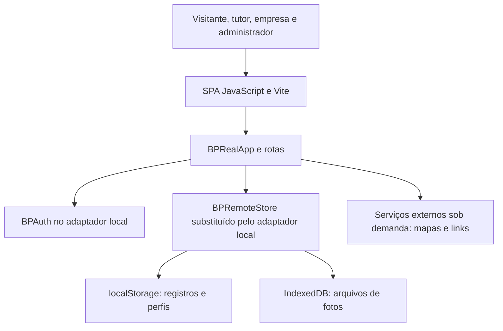

# BuscaPet — dossiê acadêmico da entrega do Projeto Integrador II

**Curso:** Análise e Desenvolvimento de Sistemas (ADS)  
**Disciplina avaliadora:** Projeto Integrador II  
**Professor avaliador informado:** Odirley Franco de Oliveira  
**Revisão documental:** 24/11/2026  
**Repositório:** https://github.com/ppedromartins11/busca-pet  
**Aplicação:** https://busca-pet-delta.vercel.app/  
**Branch de apresentação:** `apresentacao-contas-2026-11-19`  
**Baseline funcional auditada antes desta revisão de documentação:** `2507a68ec1dcaa3bd6b6f3ba4cd8e87f667e36e2`

> Este documento descreve a versão de apresentação efetivamente publicada. A revisão documental não alterou o código da aplicação. Depois do merge, o SHA da branch avança devido às alterações de documentação, mas a baseline **funcional** permanece o commit acima. O estado do deploy deve continuar sendo conferido na Vercel. O processo e as entregas anteriores permanecem preservados nos documentos históricos.

## 1. Problema e objetivo

Informações sobre animais desaparecidos, animais encontrados, avistamentos e serviços de apoio costumam circular em canais separados. O BuscaPet propõe uma aplicação web responsiva que organiza essas informações e permite ao tutor acompanhar buscas e cuidados com seus animais.

**Objetivo geral:** construir um MVP navegável, coerente e demonstrável, com publicação e consulta de alertas, acompanhamento de pets e participação de empresas do setor.

**Públicos e responsabilidades:**
- **Visitante:** consulta alertas públicos, mapa e informações públicas da Rede de Apoio.
- **Tutor:** cadastra animais, publica/edita alertas, acompanha avistamentos, gera cartazes, gerencia carteirinha e agenda.
- **Empresa:** mantém perfil comercial sujeito à aprovação; também pode usar funções de tutor.
- **Administrador:** modera cadastros e anúncios e pode utilizar as funções de tutor, mas os registros próprios não se confundem com registros de outras identidades.

## 2. Escopo entregue e evidências

| Área | Entrega identificada no código | Evidência principal | Limite |
|---|---|---|---|
| Contas e sessões | Cadastro, entrada, saída, recuperação com código local e papéis | `src/local-preview.js`, `src/real-app.js` | Autenticação **de demonstração**, sem serviço remoto |
| Pets | Cadastro, edição, fotos e vinculação ao tutor | `src/real-app.js`, `src/local-preview.js` | Dados por navegador |
| Alertas | Desaparecido/encontrado, pesquisa, filtros, estados e página de detalhe | `src/real-app.js` | Publicação não é sincronizada com outros dispositivos |
| Avistamentos | Registro, leitura pelo responsável, revisão e localização aproximada | `src/local-preview.js` | Colaboração apenas dentro da instância de dados local |
| Divulgação | Cartaz PNG e impressão do navegador | `src/pet-poster.js` | Telefone no cartaz exige consentimento explícito |
| Correspondências | Comparação transparente entre alertas de tipos opostos e ativos | `src/pet-matching.js` | Sem IA, reconhecimento facial ou garantia de identidade |
| Cuidados | Carteirinha privada e agenda com conclusão/reabertura | `src/local-preview.js`, `src/real-app.js` | Sem notificação push |
| Serviços | Diretório público de estabelecimentos e consulta por proximidade | `src/nearby-services.js`, `src/real-app.js` | Terceiros independentes; contatos e horários podem mudar |
| Empresas | Cadastro, perfil próprio e vitrine após aprovação administrativa | `src/local-preview.js`, `src/real-app.js` | Aprovação local, sem validação jurídica da empresa |
| Administração | Moderação de denúncias, anúncios, empresas e contas com motivo | `src/local-preview.js` | Não é controle de acesso seguro em servidor |
| Contato | Formulário que prepara WhatsApp após relato de pista | `src/real-app.js` | Não há chat interno nem antispam confiável entre dispositivos |
| Layout | Interface responsiva, navegação móvel e adaptação de conteúdo | `style.css` e suíte de navegador | Safari físico ainda exige conferência manual |

Os cadastros iniciais de Hex, Bold e Gargamel e os avistamentos associados são **dados semeados para demonstrar o uso**, não alegações de desaparecimentos reais. A interface pública não precisa exibir rótulo de protótipo; a documentação e a exposição oral, entretanto, devem distinguir simulação e funcionamento multiusuário.

## 3. Arquitetura da versão apresentada

A versão servida na Vercel é um frontend estático construído com `npm run build:presentation`. Neste modo, `src/local-preview.js` disponibiliza `BPAuth` e `BPRemoteStore` com implementação local; `src/events.js` monta a interface `BPRealApp`. Esta arquitetura permite reutilizar a interface preparada para outro provedor de dados sem afirmar que exista persistência remota na entrega.

O repositório também contém `src/supabase-client.js`, `src/remote-store.js`, migrations e materiais de uma **evolução conectada**. A existência desses arquivos não significa que a versão apresentada use Auth/RLS/PostgreSQL/Storage remotos.

**Critérios estruturais observáveis:** separação por responsabilidades, validação nos formulários e nos métodos locais, checagem da relação entre conta e recurso, apresentação com escape de conteúdo, roteamento e eventos, testes de regressão e uso de controle de versão. `src/real-app.js` ainda concentra muitas telas e eventos; portanto, não alegar aderência completa a SOLID, MVC ou baixo acoplamento em toda a aplicação.

## 4. Processo de desenvolvimento e engenharia de software

O histórico mostra desenvolvimento iterativo e incremental, com correções e ampliações sucessivas: aplicação de alertas → melhorias de navegação → contas de apresentação → moderação → rede de serviços e empresas → cartaz, correspondências, carteirinha e agenda → correções e homologação.

| Atividade fundamental | Como aparece no BuscaPet |
|---|---|
| Especificação | Problema, atores, regras de negócio e matriz de requisitos |
| Desenvolvimento | Módulos JavaScript, CSS, build Vite e GitHub |
| Validação | Testes automatizados, testes de navegador e verificação de fluxos |
| Evolução | Correções em branches e PRs, integração à branch da apresentação e deploy validado |

### Princípios úteis para explicar

**Coesão:** `pet-poster.js` concentra a geração do cartaz; `pet-matching.js`, a comparação dos alertas; `nearby-services.js`, o diretório/consulta geográfica.  
**Acoplamento:** a UI acessa operações por uma interface `BPRemoteStore`; trocar implementação exige respeitar contratos. Há dependências globais em `window` e arquivo de interface extenso — limitações reconhecidas.  
**Atomicidade:** no modo local, diversas operações validam, alteram uma estrutura em memória e a persistem. Isso é uma tentativa de manter operações coerentes, **não** uma transação ACID de banco de dados entre navegadores.  
**Encapsulamento e permissões:** regras da interface são complementadas por verificações de proprietário no adaptador de dados. Como o usuário controla o próprio navegador, isso não equivale a autorização independente no servidor.  
**Manutenibilidade:** controle de versão, testes e documentação reduzem risco de regressão.

## 5. Requisitos não funcionais e qualidade

- **Usabilidade:** navegação por cards, formulários identificados, busca/filtros e rotas para cada perfil.
- **Responsividade:** homologação automatizada em **320, 390, 768 e 1440 px**, incluindo verificação de ausência de rolagem horizontal e jornadas representativas.
- **Privacidade:** divulgação aproximada da localização; contato opcional em cartaz; cadastro de empresa com consentimento. Dados locais do dispositivo ainda estão sob controle de quem usa aquele navegador.
- **Confiabilidade:** verificações automatizadas detectam erros no escopo testado, não substituem testes reais com público.
- **Acessibilidade:** rótulos e alguns comportamentos de teclado; **sem auditoria WCAG completa e sem homologação com leitor de tela**.
- **Disponibilidade:** a Vercel hospeda o frontend, mas mapas, geolocalização e links externos dependem dos respectivos serviços.

## 6. Verificações e baseline verificadas

No commit de revisão `4c4f4c671e7d2d9b33b224971ce2a8c8a0a7122f` (anterior ao merge documental) houve:
- workflow **Verificação do BuscaPet**, concluído com sucesso: https://github.com/ppedromartins11/busca-pet/actions/runs/44581445999 ;
- workflow **Homologação visual da apresentação**, concluído com sucesso: https://github.com/ppedromartins11/busca-pet/actions/runs/44581445883 .

Os workflows exercitaram `npm ci`, `npm run check`, `npm test` e builds; a homologação visual utilizou Chromium e a versão de apresentação. Esses resultados foram obtidos **antes** da revisão documental, cuja alteração não envolve código de aplicação. Após editar esta documentação, verifique novamente o novo SHA de documentação e a execução disponível. Não atribuir percentuais de cobertura, teste Safari ou contagem de testes sem relatório correspondente.

**Publicação verificada em 24/11/2026:** `https://busca-pet-delta.vercel.app/`, estado **READY**, SHA funcional `2507a68ec1dcaa3bd6b6f3ba4cd8e87f667e36e2`.

## 7. Limites assumidos e riscos

1. **Não há banco compartilhado na versão apresentada**. Dois celulares não compartilham cadastros e avistamentos.
2. **Não há autenticação ou política RLS de servidor na apresentação.** As verificações locais demonstram regras de negócio e fluxos de acesso, não resistência real a usuários mal-intencionados.
3. **Não há chat interno compartilhado.** O WhatsApp usa formulário prévio e o limite de tentativas depende do navegador, podendo ser contornado.
4. **Não há confirmação de reencontro real** nem garantia de que a correspondência algorítmica identificou o mesmo animal.
5. **Parceiro cadastrado não é empresa juridicamente verificada**; contatos externos não equivalem a parceria oficial.
6. **Cenários de Safari/iPhone** requerem validação manual; Chromium não representa todos os navegadores.
7. **Alguns documentos antigos** descrevem protótipo 0.5 ou backend não homologado e servem apenas como registro histórico.

## 8. Critérios de aceite e conclusão

O sistema é **apto a demonstrar o escopo acadêmico de MVP local** desde que:
- o professor compreenda que a persistência é local, não multiusuário;
- os registros iniciais sejam reconhecidos como dados de apresentação;
- a equipe execute um roteiro principal de ponta a ponta no mesmo navegador;
- perguntas sobre arquitetura e segurança sejam respondidas sem atribuir ao modo local recursos do Supabase.

Não classificamos o BuscaPet como sistema público pronto para dados reais. Antes desse uso, seriam necessárias autenticação de servidor, banco compartilhado, RLS, proteção contra abuso, política de privacidade e homologação de integração.

**Referências dentro do projeto:** [Arquitetura](ARQUITETURA.md) · [Matriz acadêmica](MATRIZ_RASTREABILIDADE.md) · [Testes](TESTES.md) · [Roteiro](ROTEIRO_APRESENTACAO_ATUAL.md) · [Perguntas e respostas](PERGUNTAS_ENGENHARIA_PI2.md).  
**Referência de Engenharia de Software:** [Conceitos por aula](ENGENHARIA_DE_SOFTWARE_ACADEMICO.md). O material desse último documento foi organizado historicamente em torno de aulas de Engenharia de Software; não confundir o professor dessa disciplina com o avaliador do Projeto Integrador II.
