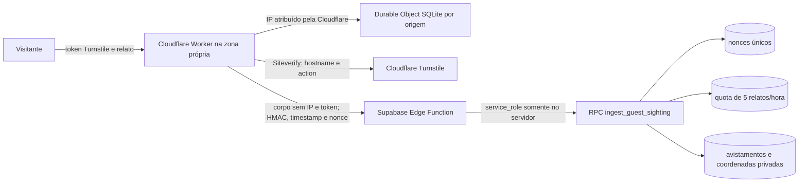

# Sprint 2.2 — ingresso de avistamentos sem conta

Implementação local. Nenhum serviço Cloudflare ou Supabase remoto foi alterado.
O frontend demonstrativo permanece inalterado.

## Arquitetura



O Worker recebe apenas `POST /report-guest-sighting` de uma origem web
permitida. `Origin` e CORS são filtros de navegador, não a autenticação da
Edge Function. A identidade da origem para quota usa apenas `CF-Connecting-IP`
associado a `request.cf` no Worker da zona própria. `X-Forwarded-For` e
cabeçalhos enviados pelo visitante não são usados. O IP é transformado com
segredo em hash antes de selecionar o Durable Object e não é enviado ao
Supabase. O objeto mantém contador persistente e consistente de **20 tentativas
por hora/IP**; indisponibilidade rejeita o pedido. A RPC mantém o teto
complementar de **5 relatos aceitos por hora/IP**.

O Worker verifica cada token Turnstile no Siteverify, inclusive `success`,
`hostname` e `action=report_guest_sighting`. Token expirado, inválido ou
reutilizado falha. Uma falha HTTP ou de rede também falha fechada. Em seguida,
o Worker remove o token do corpo e assina método, caminho canônico, timestamp,
nonce UUID, hash de origem e SHA-256 do corpo com HMAC-SHA256. A Edge aceita
somente assinatura válida com diferença máxima de 60 segundos. Um nonce único
é inserido na mesma transação que aplica quota e cria a pista; reenvio da mesma
requisição falha, inclusive entre instâncias da Edge Function. A URL Supabase
continua pública como endereço, mas uma chamada direta sem assinatura é 401.

**Decisão sobre replay:** a assinatura curta evita uso tardio de uma requisição
capturada, mas sozinha permitiria replay dentro de 60 segundos. O nonce
persistido no PostgreSQL fecha essa janela. A verificação de token único do
Turnstile ocorre no Worker e não substitui o nonce na Edge. Não armazenar
corpo, token, IP bruto ou coordenadas em logs. Erros externos devolvem apenas
códigos genéricos.

## Configuração local e externa

| Local | Variável | Conteúdo |
|---|---|---|
| Worker, segredo | `TURNSTILE_SECRET_KEY` | chave privada do widget |
| Worker, segredo | `INGRESS_HMAC_KEY` | aleatório com pelo menos 32 bytes; idêntico na Edge |
| Worker, segredo | `GUEST_SIGHTING_RATE_SECRET` | aleatório distinto para pseudônimo de IP |
| Worker, variável | `ALLOWED_ORIGINS` | origem HTTPS exata da SPA, separada por vírgula se preciso |
| Worker, variável | `EXPECTED_HOSTNAME` | hostname exato do widget, sem esquema |
| Worker, variável | `EXPECTED_ACTION` | `report_guest_sighting` |
| Worker, variável | `SUPABASE_FUNCTION_URL` | URL completa da Edge Function no projeto certo |
| Edge, segredo | `INGRESS_HMAC_KEY` | mesma chave do Worker |
| Edge, injetadas | `SUPABASE_URL`, `SUPABASE_SERVICE_ROLE_KEY` | fornecidas pelo runtime Supabase; nunca no navegador |
| Navegador futuro | site key Turnstile | valor público; a integração da SPA não faz parte desta tarefa |

Modelos sem valores reais: `cloudflare/guest-ingress/.dev.vars.example` e
`supabase/functions/.env.example`. Arquivos locais `.dev.vars` e `.env` são
ignorados pelo Git. Gerar duas chaves distintas, armazená-las em cofre e
provisioná-las pelos painéis ou comandos próprios. Não salvar valores reais na
configuração versionada, logs, scripts ou variáveis `VITE_`.

### Cloudflare, manualmente

1. Confirmar posse da zona do domínio escolhido e a disponibilidade do plano
   Workers. Criar widget Turnstile para o hostname exato da SPA; configurar a
   action `report_guest_sighting` na futura chamada do navegador. Usar widget
   e segredo diferentes para local, homologação e produção.
2. Revisar `cloudflare/guest-ingress/wrangler.jsonc`: o Worker declara Durable
   Object com armazenamento SQLite e `workers_dev=false`. Publicar somente
   mediante autorização, associar a rota exata da zona, por exemplo
   `https://api.SEU_DOMINIO/report-guest-sighting`, e manter o endereço
   `workers.dev` desabilitado. A rota precisa apontar para o Worker; a SPA
   chamará essa rota quando for integrada.
3. Configurar as quatro variáveis não secretas e os três segredos acima no
   ambiente do Worker. Em deploy autorizado, `wrangler secret put` cria uma
   nova versão; inserir os segredos antes de liberar a rota. Não habilitar
   observabilidade que registre corpo, cabeçalhos de assinatura, IP bruto ou
   localização precisa.
4. Conferir métricas de 202, 400, 401, 403, 429 e 503 e volume por rota,
   sem armazenar payloads. Testar a rota por Cloudflare, não por um proxy que
   aceite `CF-Connecting-IP` arbitrário.

### Supabase, manualmente

1. Executar o inventário de leitura em
   `supabase/preflight/remote_preflight.readonly.sql` e rever o resultado antes da
   primeira migration. Confirmar o projeto `jpnvizdhyrvliqgvyxzx`.
2. Com autorização futura, aplicar a migration inicial revisada, que inclui
   `buscapet_private.guest_sighting_nonces`. A função `verify_jwt=false` é
   intencional para visitante sem conta; a autenticação HMAC ocorre no código.
3. Provisionar **somente** `INGRESS_HMAC_KEY` como segredo próprio da Edge.
   O Supabase fornece URL e service role ao runtime. Fazer deploy da Edge
   apenas depois de configurar a chave; confirmar que chamadas diretas sem
   assinatura retornam 401. Rotacionar as chaves do Worker e da Edge de forma
   coordenada, em janela curta sem tráfego ou com suporte a duas chaves numa
   revisão futura.
4. Restringir a Data API a schemas previstos e revisar RLS, privilégios,
   Advisors e ausência de leitura pública de `sightings`, coordenadas e fotos
   privadas. O Worker nunca recebe `service_role`.

## Comandos preparados; não executados remotamente

No checkout versionado, após autorização e inventário do banco:

```powershell
npm.cmd exec -- supabase migration list --linked
npm.cmd exec -- supabase db push --dry-run --linked --skip-vault
npm.cmd exec -- supabase db push --linked --skip-vault
npm.cmd exec -- supabase secrets set --project-ref jpnvizdhyrvliqgvyxzx --env-file supabase/functions/.env
npm.cmd exec -- supabase functions deploy report-guest-sighting --project-ref jpnvizdhyrvliqgvyxzx
```

Para Cloudflare, usar a versão fixada em `package-lock.json`. Na raiz do
repositório, após revisão da conta e da rota:

```powershell
npm.cmd exec -- wrangler deploy --config cloudflare/guest-ingress/wrangler.jsonc
npm.cmd exec -- wrangler secret put TURNSTILE_SECRET_KEY --config cloudflare/guest-ingress/wrangler.jsonc
npm.cmd exec -- wrangler secret put INGRESS_HMAC_KEY --config cloudflare/guest-ingress/wrangler.jsonc
npm.cmd exec -- wrangler secret put GUEST_SIGHTING_RATE_SECRET --config cloudflare/guest-ingress/wrangler.jsonc
```

Configurar as variáveis não secretas e a rota no Dashboard antes de liberar
tráfego. Os comandos `secret put` acima são mutações remotas e **não foram
executados**. A ordem de provisionamento deve manter a rota inacessível até
Worker, segredo compartilhado e Edge passarem na verificação.

## Rollback

1. Desabilitar a rota Cloudflare ou colocar o Worker em resposta 503; isso
   interrompe novos relatos sem afetar o feed e os dados existentes.
2. Se houver regressão no Worker, reimplantar a versão anterior conhecida e
   manter a rota desabilitada até validar a assinatura correspondente.
3. Se houver regressão na Edge, reimplantar a versão anterior **compatível com
   HMAC e nonce**. Não voltar à versão que aceitava `cf-connecting-ip` sem
   autenticação. Não reverter a migration inicial em banco com dados reais;
   tratar correção por nova migration revisada e backup.
4. Acompanhar filas de suporte e logs sem payload; tokens Turnstile já usados
   não podem ser reenviados. Reabrir a rota só após testes negativos e positivos.

## Custos, limites e riscos

Em outubro de 2026, a documentação informa [100 mil requisições/dia no
Workers Free](https://developers.cloudflare.com/workers/platform/pricing/),
[100 mil requisições/dia e 13 mil GB-s/dia para Durable Objects SQLite no
Free](https://developers.cloudflare.com/durable-objects/platform/pricing/),
[Turnstile Free com até 20 widgets e 10 hostnames por
widget](https://developers.cloudflare.com/turnstile/plans/) e [500 mil
invocações de Edge Functions na quota Free do
Supabase](https://supabase.com/docs/guides/platform/manage-your-usage/edge-function-invocations).
Confirmar quotas e preços atuais antes do deploy; **nenhum plano pago foi
criado**. Cada tentativa validada consome uma chamada ao Durable Object e uma
ao Siteverify; falhas antes do Siteverify ainda consomem quota do Worker/DO.
A quota por IP pode afetar pessoas atrás de NAT e não impede
ataques distribuídos. Turnstile reduz abuso, não prova a veracidade do relato.
O texto livre ainda pode conter dados pessoais ou localização exata. A
retenção dos nonces precisa de rotina operacional: proposta inicial de 48 h,
com teste em desenvolvimento, lote limitado e backup. Rotação coordenada do
segredo, política de resposta a abuso e domínio final ainda dependem de
decisão operacional.

## Evidência local desta revisão

- `npm test`: 43/43 testes Node, incluindo cinco testes do Worker com Siteverify,
  Edge e Durable Object simulados.
- `supabase db reset --local` numa cópia isolada e `supabase test db`: 35/35
  testes pgTAP. `supabase db lint --schema public,buscapet_private`: sem erros.
- HTTP local real da Edge e PostgreSQL: assinatura ausente/incorreta, corpo
  alterado, timestamp vencido, replay, quota e privacidade aprovados.
- Fluxo Worker → Edge → PostgreSQL local aprovado, com Siteverify e transporte
  do Durable Object simulados. Teste HTTP de Storage local aprovado.
- `npm run check`, `npm run build`, `npm run test:browser` e
  `wrangler deploy --dry-run` aprovados. O dry-run não publica Worker.

Não houve teste no runtime Cloudflare hospedado, nem com Turnstile real, nem
teste remoto Supabase. Esses pontos permanecem no plano de homologação acima.

## Plano de testes remotos após autorização

- Inventário e migration aplicados em projeto de desenvolvimento, com teste
  SQL e Advisors remotos; não usar banco de produção para testes destrutivos.
- Chamada direta à Edge sem assinatura, assinatura errada, timestamp vencido,
  corpo alterado e replay de nonce: rejeição sem criar pista.
- Pela rota Worker: token real correto, token inválido/reutilizado, hostname e
  action divergentes, IP/cabeçalhos falsificados, excesso de 20 tentativas e
  de 5 relatos aceitos, indisponibilidade do DO/Siteverify/Supabase.
- Verificar que `anon` não lê avistamentos ou coordenadas e que contas de
  terceiros não leem dados privados. Verificar ausência de dados pessoais em
  logs e confirmar métricas/alertas antes de abrir o fluxo.
