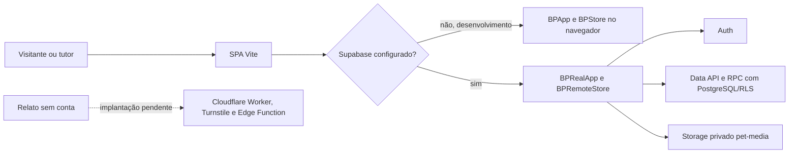

# BuscaPet — verificação acadêmica final

**Data:** 16/11/2026 (America/Cuiaba). **Prazo:** 20/11/2026. **Escopo:** checkout local, foco nas jornadas principais e evidências do semestre. Este relatório não certifica o serviço conectado. A [matriz de rastreabilidade](MATRIZ_RASTREABILIDADE.md) classifica cada RF01–RF16 e RNF01–RNF09.

## 1. Fonte e baseline

- `main` e `origin/main` no início da revisão: `cfb9c5744ba2b789601e3490593915c8a32f2c81`. Este é o **commit anterior**, não a baseline da entrega atual: havia alterações de aplicação, migrations, testes e documentos ainda sem commit no início da inspeção.
- A branch remota `docs/engenharia-software-semestre-2026` aponta para `483d2a513d4f6550db8450103fe8860c5d52f12b` e contém matriz, referência acadêmica, teste estático e workflow. O PR [#1](https://github.com/ppedromartins11/busca-pet/pull/1) está em rascunho, sem merge. A matriz e a referência foram trazidas para este checkout e atualizadas; o teste estático dessa branch não foi copiado porque só confirma presença de arquivos/padrões de texto.
- Não foi encontrado arquivo de aula no checkout. A referência acadêmica versionada cobre os títulos das aulas 01–08 e 11, mas não fornece RF15–RF16 nem RNF08–RNF09. Esses IDs estão explicitamente sem critério na matriz. Não inferir seus enunciados.
- A baseline acadêmica local é a branch `entrega-academica-2026-11-20`, marcada pela tag local `academico-2026-11-20`; obter seu **SHA de commit** com `git log -1 --format=%H academico-2026-11-20`. A tag cobre somente a allowlist de aplicação, migrations, testes e documentação acadêmica revisada. Arquivos operacionais/históricos não selecionados permanecem no checkout e não fazem parte da baseline. Não apresentar `cfb9c57` ou `483d2a5` como SHA final do produto atual.

## 2. Processo, incrementos e configuração

| Incremento real | Evidência | Mudança observável |
|---|---|---|
| Protótipo 0.5 | `SPRINTS.md`, `store.js`, `app.js`, `tests/browser.cjs` | Fluxos locais e permissões simuladas no navegador |
| MVP conectado | commit `ad225ae`; `auth.js`, `remote-store.js`, migration inicial | Auth, Data API, RLS e Storage no código |
| Fotos e mapa | commits `bd74e19`, `7f4fde0`, `010680d`; `MAPA_REAL.md` | Fotos privadas, localização pública aproximada e mapa |
| Administração | commits `296631c`, `05a41a0`, `2a650f5`, `cfb9c57` | Diretório, moderação e triagem |
| Candidato R4 local | `RELEASE_R4_PREPARACAO.md`, cinco migrations R4 pré-existentes no checkout, `remote-store.js`, `real-app.js` | Contratos de leitura, manutenção e ajustes da Home/Minha Área; sem aplicação remota nesta revisão |
| Adequação acadêmica atual | matriz, referência acadêmica, workflow, este relatório e `scripts/start-demo.mjs` | Rastreabilidade, CI no checkout e demonstração isolada repetível |

O processo comprovável é incremental: commits e migrations registram versões; testes verificam regressões; a revisão atual identifica lacunas sem abrir uma nova fase funcional. Nenhuma estimativa histórica de horas foi localizada. Para o prazo, a incerteza maior é integração externa; estimar tempo sem dados seria especulativo.

## 3. Arquitetura e padrões

**ADR-01:** SPA web responsiva evita instalar app nativo; testes em múltiplas larguras e teclado são necessários. **ADR-02:** dois modos explícitos em `events.js`; o modo local guarda dados somente no navegador e não simula integração remota. **ADR-03:** `remote-store.js` centraliza acesso a Data API/Storage, enquanto RLS/RPC sustentam autorização efetiva no servidor. **ADR-04:** mapa público usa localização aproximada autorizada, sem expor coordenada privada. **ADR-05:** migrations versionadas e testes SQL registram evolução do esquema, mas presença no repositório não prova aplicação em qualquer ambiente.

Padrões observados: adaptador de dados em `remote-store.js`, delegação de eventos em `events.js`, funções reutilizadas de validação e apresentação em `validation.js` e `views.js`. A seleção entre `BPApp` e `BPRealApp` é uma estratégia simples de modo. O legado ainda usa contratos globais em `window`; não há evidência para afirmar MVC ou conformidade integral a SOLID/GoF.

## 4. Verificação e métricas desta execução

| Comando/ensaio | Resultado | Limite |
|---|---|---|
| `npm.cmd run check` | passou | Sintaxe JavaScript |
| `npm.cmd test` | **90/90**, zero falhas | Unitários e mocks; sem backend real |
| `npm.cmd run build` com URL/key fictícias locais | passou; bundle JS 641,37 kB, aviso >500 kB | Empacotamento, sem publicação |
| `tests/home-ui.browser.cjs` | passou em 320/390/768/1024/1440 px | Fixtures; rede Supabase bloqueada |
| `tests/browser-regressions.cjs` | passou; zero exceções | Endpoint fictício local |
| `tests/admin-reports.browser.cjs` e `admin-moderation.browser.cjs` | passaram; 320/390/768/1440 px | Fixtures; sem RPC real |
| `tests/browser.cjs` via `npm.cmd run demo -- 5180` | passou: 18 fluxos, 19 rotas, 11 larguras, zero erros/overflow | Protótipo local; login e persistência simulados |
| `docker info` e `supabase status` | indisponíveis: Docker Desktop Linux Engine não responde | Sem pgTAP, Storage ou integração local nesta execução |

O workflow `.github/workflows/verificacao.yml` roda `npm ci`, check, testes e build em PR, push nas branches listadas e acionamento manual. Há duas execuções GitHub Actions **aprovadas no SHA `483d2a5`**, [PR](https://github.com/ppedromartins11/busca-pet/actions/runs/43894357371) e [push](https://github.com/ppedromartins11/busca-pet/actions/runs/43894349708). O workflow ainda não rodou sobre este checkout modificado; os comandos locais acima não são uma aprovação de CI para a nova baseline.

## 5. Correção prioritária desta revisão

O ensaio inicial de `tests/browser.cjs` falhou antes da jornada porque o Vite carregou `.env` mesmo com variáveis vazias no shell. A página entrou no modo conectado. O servidor foi interrompido e a leitura automática da Home não executou escrita. `scripts/start-demo.mjs` agora inicia o Vite com diretório de ambiente vazio e sem variáveis `VITE_SUPABASE_*`; `npm.cmd run demo` reproduz o protótipo com o `.env` existente no checkout. O teste completo de navegador passou nessa condição. `README.md` documenta o comando e corrige a descrição desatualizada de denúncias/moderação. Nenhuma outra falha impeditiva das jornadas locais foi reproduzida; por isso não houve alteração de regras, Auth ou SQL nesta revisão.

## 6. Riscos para 20/11

| Risco | Probabilidade qualitativa | Impacto | Resposta para a entrega |
|---|---|---|---|
| Apresentar o modo conectado apontando para produção | Alta se usar `npm run dev` sem conferir `.env` | Alto | Usar `npm.cmd run demo`, conferir aviso de protótipo local |
| Backend isolado indisponível, Docker parado | Alta no ambiente atual | Alto para demonstração conectada | Não prometer integração remota; usar roteiro local com rótulo explícito |
| Candidato R4 diferente do `main` remoto | Alta, pois há mudanças não commitadas | Alto | Revisar allowlist, criar SHA de entrega local e repetir verificações nesse SHA |
| RF15–RF16 e RNF08–RNF09 sem enunciado | Confirmado | Médio para avaliação acadêmica | Solicitar enunciados originais e revisar matriz; não fabricar critérios |
| E-mail/SMTP ou RLS não homologados no alvo conectado | Não quantificada | Alto | Não depender desses fluxos na apresentação sem ensaio com sandbox e duas contas |
| Acessibilidade incompleta em leitor de tela/outros navegadores | Não quantificada | Médio | Demonstrar apenas teclado/larguras testados; planejar validação posterior |

## 7. Manutenção e reúso com exemplos reais

- **Corretiva:** commit `2860597` corrigiu detalhes de alerta e adicionou regressões; nesta revisão foi corrigido o procedimento que carregava `.env` no modo demonstrativo.
- **Preventiva:** commit `fe7c3f4` adicionou testes de rascunhos e refresh; o workflow de CI recuperado verifica sintaxe, testes e build. Testes SQL versionados previnem regressões futuras, sem certificação atual de banco.
- **Perfectiva:** Home R4 no checkout local melhora apresentação, estados vazio/erro e responsividade; `home-ui.browser.cjs` passou com fixtures. Mudanças visuais pré-existentes não são atribuídas a esta revisão.
- **Reúso:** `views.js`, `validation.js`, `ui-preferences.js` e módulos compartilhados são reutilizados entre telas. `package.json` declara Vite, Supabase JS, Leaflet e Playwright Core; não houve nova dependência.

## 8. Cobertura das aulas e pendências

| Aula | Evidência | Situação |
|---|---|---|
| 01 Introdução | problema, produto, requisitos e limites neste relatório | Atendida |
| 02 Processos/ciclo de vida | incrementos, sprints e histórico Git | Atendida como processo incremental; sem Scrum integral alegado |
| 03 Projeto/implementação | módulos e jornadas locais testadas | Atendida localmente; integração pendente |
| 04 Arquitetura | diagrama e ADRs acima | Atendida, implantação remota parcial |
| 05 Padrões | adaptador, delegação, reúso com evidência | Atendida no escopo observado |
| 06 Estimativas/métricas/riscos | contagens executadas e matriz de riscos | Parcial: estimativas históricas não registradas |
| 07 Configuração/melhoria | commits, migrations e workflow | Parcial: SHA final do candidato ainda pendente |
| 08 Confiança/qualidade/gestão | testes negativos, teclado, limites e RLS versionada | Parcial: RLS/Storage não revalidados nesta execução |
| 11 Evolução/manutenção/reúso | commits corretivos, prevenção e módulos reutilizados | Atendida com exemplos reais |

**Impedimentos para demonstrar o modo conectado até sexta:** definir um sandbox autorizado, disponibilizar Docker ou outra stack isolada, validar migrations/RLS/Storage com duas identidades, configurar e testar Auth/e-mail, e repetir a jornada completa. Isso não impede a apresentação **acadêmica local**, desde que ela seja nomeada como demonstração no navegador. Os quatro enunciados ausentes impedem afirmar cobertura integral de RF01–RF16/RNF01–RNF09. A baseline local precisa de execução do CI sobre seu SHA para que se possa afirmar aprovação do pipeline nessa versão; os comandos locais comprovam somente o checkout testado.

**Evolução posterior:** leitor de tela e outros navegadores, redução do bundle, decomposição dos módulos legados, favoritos/tarefas conectados e publicação do ingresso sem conta. Nenhum desses itens foi iniciado nesta revisão.
